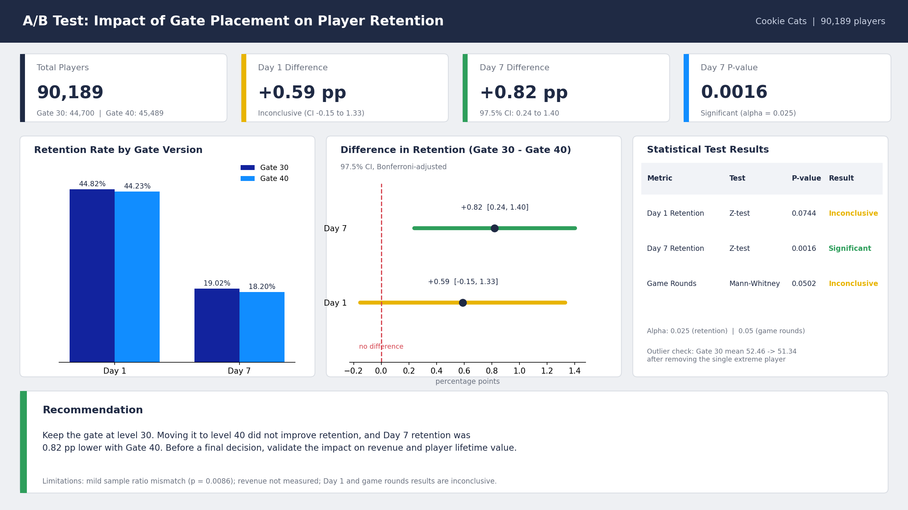
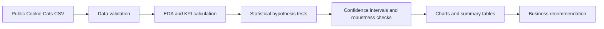
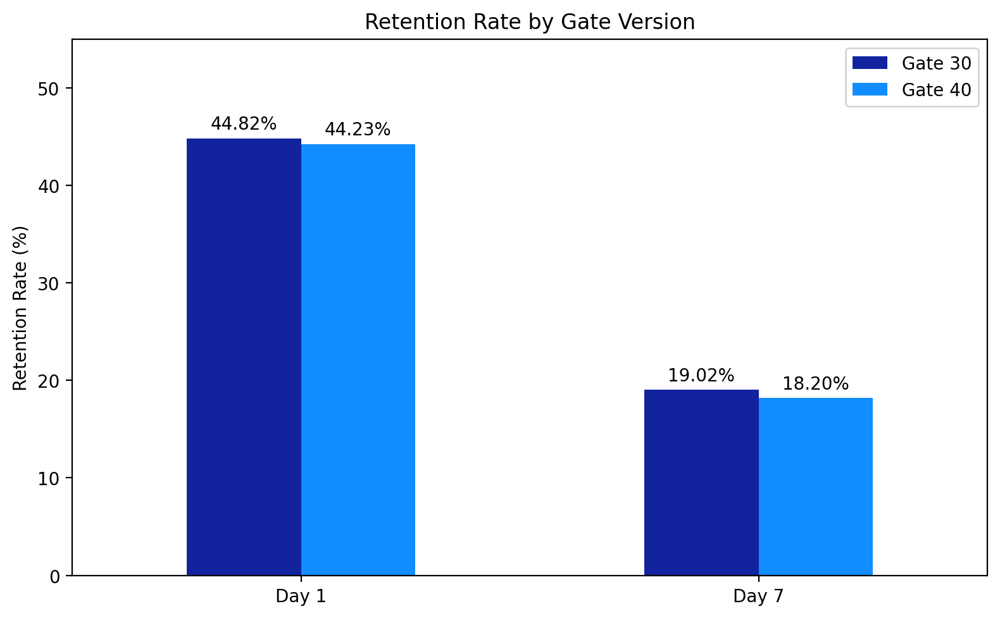
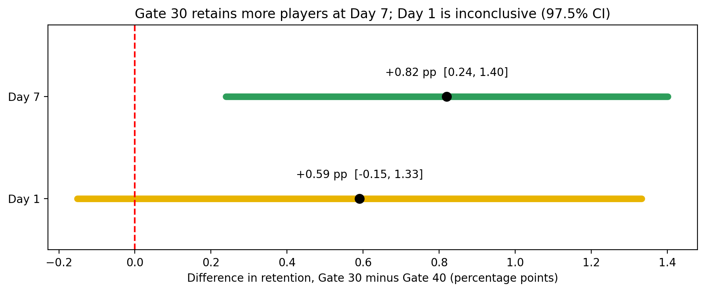
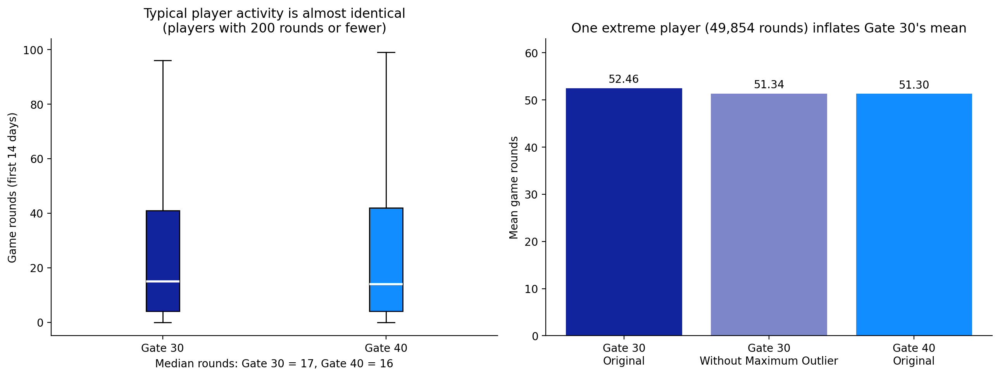
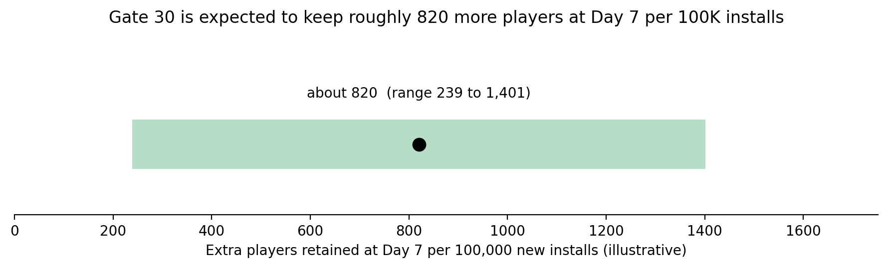

# Cookie Cats | A/B Testing & Player Retention Analysis

**Python · Experiment Design · Data Quality · Hypothesis Testing · Business Decision-Making**

> **Executive decision:** The observed data favor **keeping the first gate at level 30**: Day 7 retention is **19.02% vs 18.20%** under Gate 40 (difference **+0.82 percentage points**, two-sided **p = 0.001554**). The result survives correction for two retention tests. **Before an actual rollout decision**, investigate a sample-allocation warning and assess monetization, which this dataset does not measure.



## 1. Project Overview

This project evaluates whether moving a progression gate from **level 30 (control)** to **level 40 (treatment)** in the mobile puzzle game *Cookie Cats* improves player retention. Using a public experiment dataset of **90,189 players**, the analysis follows a product-analytics workflow: data validation, exploratory analysis, statistical testing, robustness checks, visual reporting and a business recommendation.

## 2. Business Problem & Objectives

The game uses progression gates that temporarily pause player progress. Moving a gate later may change how users engage with the game; the company needs evidence before changing the experience.

**Questions answered:**
- Does Gate 40 improve **Day 1** or **Day 7** retention over Gate 30?
- Are observed differences statistically supported **and** practically relevant?
- Is the experiment trustworthy enough to inform a product decision?
- Does player activity, measured by rounds played, support the retention findings?

## 3. Dataset Overview & KPIs

**Dataset:** [Mobile Games: A/B Testing — Cookie Cats (Kaggle)](https://www.kaggle.com/datasets/yufengsui/mobile-games-ab-testing). The raw file supplied for this analysis is included at [`data/cookie_cats.csv`](data/cookie_cats.csv). The analysis and conclusions below come from that CSV and the notebook, not from external results.

**Grain:** **one row per assigned player** (`userid`); 90,189 unique player records across two test groups.

| Dataset field / KPI | Business meaning | How it is measured |
|---|---|---|
| `userid` | Experiment unit | Unique player identifier |
| `version` | Control vs treatment | `gate_30` / `gate_40` |
| Day 1 retention | Early return engagement | Mean of binary `retention_1` within each group |
| Day 7 retention | Longer-term return engagement | Mean of binary `retention_7` within each group |
| `sum_gamerounds` | Activity / engagement proxy | Number of rounds played in the first 14 days |
| Retention lift | Effect of gate placement | Gate 30 rate minus Gate 40 rate, **percentage points** |

Retention flags indicate a return on the specified day; they are **not** inferred from `sum_gamerounds`.

## 4. Tools & Analysis Workflow

**Stack:** Python, pandas, NumPy, Matplotlib, seaborn, SciPy, statsmodels, Jupyter Notebook.



This is a **single-table statistical analysis**, not a SQL warehouse, star schema or Power BI dashboard. The reproducible outputs are five PNG figures and six CSV result tables.

## 5. Data Cleaning & Validation

| Check / decision | What was done | Why it matters |
|---|---|---|
| Missingness and duplicate IDs | Checked nulls, duplicate records and `userid` uniqueness; no removal required | Protects record-level accuracy and group denominators |
| Valid experiment groups | Verified `gate_30` and `gate_40`; checked negative round values | Ensures the analysis compares valid groups and activity values |
| Zero-round players | **Retained all 3,994** zero-round players | Dropping players based on post-assignment activity could introduce selection bias |
| Retention consistency | Checked flag types and Day 1 / Day 7 combinations | A player may return on Day 7 without returning on Day 1 |
| Extreme game rounds | Identified the **49,854-round** player and checked its impact separately | A single high value can distort the mean without invalidating retention |
| Sample ratio mismatch (SRM) | Compared observed allocation to an assumed 50/50 split | Potential logging or randomization issues must be reviewed |

**Important nuance:** zero rounds does **not** automatically mean not retained in the supplied data: 87 of those records are flagged retained on Day 1 and 29 on Day 7. Retention metrics are always computed from their actual flags. **No rows are removed from the main retention analysis.**

## 6. Exploratory Data Analysis (EDA)

- **Gate 30:** 44,700 players (**49.56%**). **Gate 40:** 45,489 players (**50.44%**).
- Game rounds are strongly **right-skewed**; the 49,854-round observation inflates the Gate 30 mean.
- Group medians are close (**17** versus **16** rounds), so central tendency alone does not support a strong engagement claim.
- Observed retention is higher for Gate 30 on both days; statistical tests are needed before concluding that the differences are reliable.

## 7. Statistical Hypothesis Testing

**Hypotheses:** for each retention KPI, **H₀:** Gate 30 and Gate 40 have equal retention proportions; **H₁:** the proportions differ (two-sided).

- **Two-proportion Z-tests** for independent binary retention metrics.
- **Bonferroni adjustment** across two retention hypotheses: family-wise α = 0.05, per-test **α = 0.025**.
- **97.5% Newcombe confidence intervals** for Gate 30 minus Gate 40 retention differences.
- **Normal-approximation power / minimum detectable effect (MDE)** as a *retrospective sensitivity check* (80% power); not a pre-experiment sample-size plan.
- **Mann–Whitney U** as a **secondary exploratory** test of skewed game-round distributions.

| Outcome | Gate 30 | Gate 40 | Difference (Gate 30 − Gate 40) | p-value | Interpretation |
|---|---:|---:|---:|---:|---|
| **Day 1 retention** | 44.82% | 44.23% | +0.59 pp | 0.074410 | Inconclusive after correction |
| **Day 7 retention** | 19.02% | 18.20% | +0.82 pp | 0.001554 | Significant after correction |
| **Game rounds, median** | 17 | 16 | +1 round | ≈0.0502 | Not significant at 0.05; not proof of equivalence |

**97.5% intervals:** Day 1 difference **−0.15 to +1.33 pp** (includes zero); Day 7 difference **+0.24 to +1.40 pp** (excludes zero).

## 8. Key Findings & Visualizations

### Retention rates



Gate 30 is higher on both observed rates. Only the **Day 7** difference clears the adjusted statistical threshold.

### Uncertainty around the lift



The Day 7 interval stays above zero; the Day 1 interval crosses zero. Both refer to **Gate 30 minus Gate 40**.

### Engagement and outlier sensitivity



The Gate 30 mean falls from **52.46** to **51.34** rounds after excluding *only for sensitivity analysis* one extreme record, versus **51.30** for Gate 40. The original full dataset is still used for the main analysis and the Mann–Whitney test.

### Illustrative scale of the impact



Applying the observed Day 7 lift to a **hypothetical 100,000-player cohort** implies roughly **820 more Day 7 retained players** with Gate 30 (interval-based range: approximately **240–1,400**). This is a scenario illustration, **not observed company impact** or a revenue estimate.

## 9. Analytical Decisions & Trade-offs

| Decision | Rationale | Trade-off / caution |
|---|---|---|
| Python instead of a dashboard-first workflow | The central question needs hypothesis tests, confidence intervals and sensitivity analyses | A notebook is less interactive than a dashboard but reproducible and auditable |
| Analyze all assigned players | Preserves assignment-based comparison, including zero-round users | Measures the effect of **assignment**, not solely the effect on players who reached the gate |
| Do not bulk-delete outliers | A long engagement tail can be genuine | Report medians and sensitivity rather than trusting means blindly |
| Adjust for two retention tests | Limits inflated false-positive risk across two tested retention outcomes | More conservative than independent 5% tests |
| Flag the 50/50 allocation check | SRM chi-square **p ≈ 0.0086** merits investigation | Small percentage imbalance alone does not resolve possible allocation or logging problems |
| Compare statistical and practical effects | A small retention difference can matter at scale | Revenue, cost and player lifetime value are unavailable |

## 10. Business Insights & Recommendation

**Recommendation from the available retention data:** **do not move the first gate to level 40**; retain Gate 30 while validating experiment integrity and reviewing monetization outcomes.

The strongest result is the **+0.82 pp Day 7 retention** advantage for Gate 30. Day 1 evidence is inconclusive, and game-round comparisons do not establish an improvement under Gate 40. Because gates may affect purchases and ads as well as retention, this should be treated as a **retention-based recommendation**, not a fully evaluated profitability decision.

## 11. Limitations & Future Improvements

1. **Allocation / logging audit:** verify that 50/50 was the intended split and investigate the SRM signal before any live rollout.
2. **Unobserved monetization:** analyze purchase conversion, ad revenue and player lifetime value alongside retention.
3. **Limited follow-up:** measure longer-term retention and exposure to the gate; the supplied data cover Day 1, Day 7 and 14-day rounds.
4. **Single-experiment uncertainty:** validate findings with additional experimentation before claiming generality.
5. **Secondary activity metric:** near-threshold game-round test is exploratory and does not demonstrate either a meaningful difference or equivalence.

## 12. Project Structure & How to Run

```text
Cookie-Cats-AB-Testing/
├── README.md
├── cookie_cats_ab_testing.ipynb
├── requirements.txt
├── .gitignore
├── data/
│   └── cookie_cats.csv
├── figures/
│   ├── 01_retention_difference_ci.png
│   ├── 02_retention_by_gate.png
│   ├── 03_game_rounds.png
│   ├── 04_practical_impact.png
│   └── 05_executive_summary.png
└── results/
    ├── player_distribution.csv
    ├── retention_comparison.csv
    ├── statistical_results.csv
    ├── confidence_intervals.csv
    ├── game_rounds_summary.csv
    └── outlier_sensitivity.csv
```

**Run locally** (Python 3.10+ recommended):

```bash
cd Cookie-Cats-AB-Testing
python -m pip install -r requirements.txt
jupyter notebook cookie_cats_ab_testing.ipynb
```

In Jupyter, select **Kernel → Restart & Run All**. Run it from the project root. The notebook reads `data/cookie_cats.csv` and regenerates the `results/` tables and `figures/` images. No API keys or external data connections are needed.

---

**Source attribution:** [Kaggle — Mobile Games: A/B Testing](https://www.kaggle.com/datasets/yufengsui/mobile-games-ab-testing). See the source page for dataset licensing and reuse terms.
